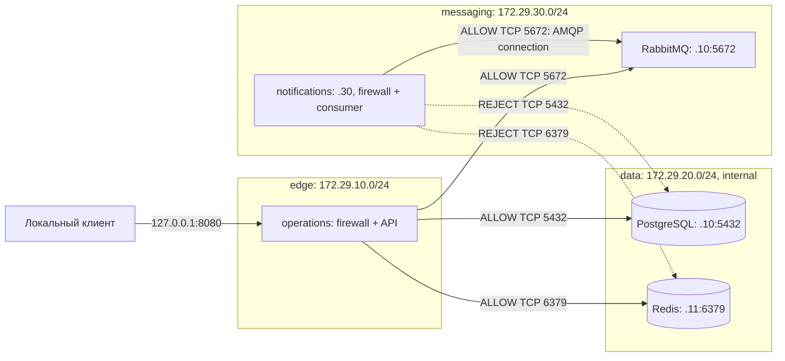

# ДЗ 4. Сегментация сетей и Firewall

После выполнения ДЗ 5 адреса db/broker обслуживают HAProxy перед кластерами. Матрица доступа приложений сохранена, `scripts/verify_hw4.py` проходит. Внутренние команды PostgreSQL/RabbitMQ теперь выполняются на pgN/db-backup и rabbitN. Дополнительная control-сеть и HA-компоненты описаны в [HW5.md](HW5.md). Ниже сохранён исходный разбор ДЗ 4 до расширения стенда.

Источник требования: семинар 4, страница 26, [материалы курса](course/README.md). Требуется сегментировать сети микросервисов, настроить Firewall и продемонстрировать явное разрешение и явный запрет обмена пакетами.

## Реализация

Два прикладных сервиса: operations сохраняет и читает расходы, notifications потребляет `operation.created` из RabbitMQ и логирует уведомление. Потребление вынесено из operations, поэтому сервисы не конкурируют за одно сообщение. У notifications нет пароля PostgreSQL, доступа к data-сети и публичного HTTP API.



Стрелка notifications → RabbitMQ обозначает инициатора TCP-соединения. События идут от брокера к consumer по этому соединению; ответы разрешены правилом ESTABLISHED,RELATED.

| Сеть | Участники и IP | Назначение |
|---|---|---|
| edge `172.29.10.0/24` | operations `.10` | Вход с хоста, только `127.0.0.1:8080` опубликован |
| data `172.29.20.0/24` | db `.10`, cache `.11`, operations `.20` | Внутренняя сеть хранилищ, `internal: true` |
| messaging `172.29.30.0/24` | broker `.10`, operations `.20`, notifications `.30` | AMQP; порты на хост не публикуются |

Operations подключён ко всем трём сетям. Notifications подключён только к messaging. Неявная общая default-сеть не используется. IP зафиксированы, чтобы правила не зависели от порядка создания контейнеров. При изменении IP-плана нужно согласованно обновить Compose, firewall и проверку.

Messaging имеет обычный bridge gateway, поэтому у notifications есть маршрут для попытки обращения к IP другой сети. Это позволяет увидеть именно явный REJECT и увеличение его счётчика, а не только ошибку отсутствия маршрута. Доступ приложения за пределы разрешённого AMQP закрывает OUTPUT Firewall. Data дополнительно изолирована Docker. У брокера нет прикладного OUTPUT Firewall; доступность сети не означает публикацию его порта на хост.

## Матрица доступа

| Инициатор | Получатель | Правило |
|---|---|---|
| Локальный клиент | operations TCP 8080 | Публикация на loopback + INPUT ACCEPT |
| operations | db `172.29.20.10:5432` | OUTPUT ACCEPT `allow-db` |
| operations | cache `172.29.20.11:6379` | OUTPUT ACCEPT `allow-cache` |
| operations / notifications | broker `172.29.30.10:5672` | OUTPUT ACCEPT `allow-broker` |
| notifications | db `172.29.20.10:5432` | OUTPUT REJECT `deny-db` |
| notifications | cache `172.29.20.11:6379` | OUTPUT REJECT `deny-cache` |
| notifications | operations `172.29.30.20:8080` | OUTPUT REJECT `deny-other-output` |
| operations | db на другом порту, например 5433 | OUTPUT REJECT `deny-other-output` |
| Приложения | Остальные новые сетевые соединения | REJECT; базовые INPUT/OUTPUT/FORWARD policy DROP |

Firewall устанавливается в собственном network namespace каждого прикладного контейнера скриптом `network/entrypoint.sh`. Правила хоста и чужие контейнеры не изменяются. Loopback (включая встроенный DNS Docker и локальные healthcheck) и ответы ESTABLISHED,RELATED разрешены. У operations входящий TCP 8080 разрешён; ограничение публикации с хоста задаёт Compose. У notifications удалённые входящие подключения закрыты, health endpoint слушает только `127.0.0.1:8081`.

IPv6-трафик закрыт политиками DROP, кроме loopback, чтобы не появлялся обход IPv4-политики. При ошибке установки правил entrypoint завершится и не запустит приложение. Правила применяются заново при каждом старте контейнера.

Установку выполняет root с NET_ADMIN, SETUID, SETGID; остальные capabilities удалены. Затем `su-exec` запускает Python от nobody, у PID 1 эффективные capabilities равны нулю. Включён no-new-privileges. Для осмотра правил используется административный `docker compose exec --user root`; доступ к Docker остаётся административной границей. Это учебный стенд с firewall у приложений, а не полная защита инфраструктурных служб.

## Запуск и проверка

Нужен Linux Docker Engine или Docker Desktop с поддержкой NET_ADMIN/iptables, Compose 2.33.1+ (используется `gw_priority`) и Python 3 для сценария проверки. Пароль создаётся по инструкции README; ранее созданную `.env` сохраняйте. Сборка требует доступа к реестру образов, Alpine-пакетам и PyPI.

```sh
docker compose up --build -d --wait
docker compose ps
python3 scripts/verify_hw4.py
```

Проверка создаёт один расход 450.50 с категорией «ДЗ 4» и проверяет:

1. Python PID 1 работает от nobody без effective capabilities; политики FW закрыты по умолчанию.
2. Notifications подключён только к messaging.
3. Одинаковое TCP-подключение к `172.29.20.10:5432` проходит из operations и отклоняется из notifications. Аналогично проверяется Redis.
4. Оба сервиса подключаются к RabbitMQ по имени `broker`.
5. Запрещены обращения notifications к operations и operations к неразрешённому порту БД.
6. После отрицательных проб увеличились счётчики именно `deny-db` и `deny-cache`. Остановка БД, ошибка DNS или таймаут не засчитываются как доказательство FW.
7. POST расхода успешен, первый GET идёт в БД, второй — в Redis; notifications получил событие с тем же UUID.

Для осмотра правил со счётчиками:

```sh
docker compose exec --user root operations iptables -nvxL
docker compose exec --user root notifications iptables -nvxL
docker compose logs operations notifications
```

Для ручной защиты выполните **одну и ту же команду**, меняя только сервис:

```sh
docker compose exec --user nobody operations python -c "import socket; socket.create_connection(('172.29.20.10', 5432), timeout=2).close(); print('ALLOW')"
docker compose exec --user nobody notifications python -c "import socket; socket.create_connection(('172.29.20.10', 5432), timeout=2).close(); print('ALLOW')"
```

Первая завершается с `ALLOW`, вторая — с `OSError: [Errno 113] Host is unreachable` и ненулевым кодом. Причина отказа подтверждается ростом счётчика `deny-db`:

```sh
docker compose exec --user root notifications iptables -nvxL OUTPUT
```

Демонстрация не требует отключать firewall, останавливать БД или удалять данные. Счётчики обнуляются при пересоздании/перезапуске контейнера. Стенд останавливается через `docker compose down`, именованные тома сохраняются.

## Фактическая проверка

9 ноября 2026 года на локальном Docker Desktop: сборка и `docker compose up --build -d --wait` прошли; все пять контейнеров healthy. `python3 scripts/verify_hw4.py` завершился `ДЗ 4: all checks passed`.

Подтверждены ALLOW operations → PostgreSQL/Redis, ALLOW обоих сервисов → RabbitMQ, DENY notifications → PostgreSQL/Redis/operations, DENY operations → неразрешённый порт БД. Счётчик `deny-db` вырос с 1 до 2, `deny-cache` — с 0 до 1. Создан расход `6c612f1b-e8d6-42af-9273-120344821ac2`, чтение прошло последовательно из database/cache, событие потреблено notifications. Это результат локального прогона, не обещание доступности при любых сбоях.

После перезапуска operations и notifications полный сценарий повторно прошёл: правила восстановились, оба счётчика запрета выросли с 0 до 1, событие нового расхода `0b69e3e4-9930-4e01-9f4a-5b9dd69429f1` получено notifications.

ДЗ 5 (HA, параметры обслуживания, backup) этим изменением не закрывается.

Справка по использованным настройкам: [сети Compose](https://docs.docker.com/reference/compose-file/networks/), [cap_add/cap_drop, security_opt и gw_priority](https://docs.docker.com/reference/compose-file/services/).
