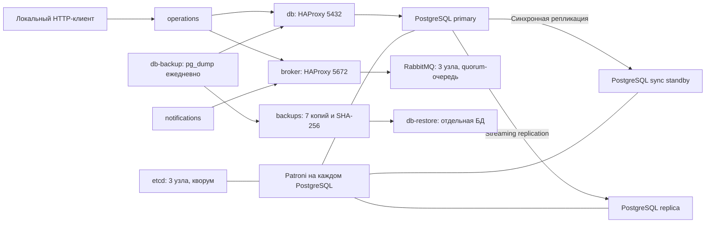

# ДЗ 5. Отказоустойчивость и восстановление

Требования: этап 5 отдельного документа о промежуточной защите, стр. 3. Нужны аварийное завершение primary БД и переключение на standby, аналогичная проверка брокера, backup/restore и обоснованные параметры обслуживания. Краткое ДЗ семинара 5 дополнено этими конкретными сценариями.

## Архитектура



Operations и notifications используют прежние адреса `db:5432` и `broker:5672`. IP этих точек остаются `172.29.20.10` и `172.29.30.10`, поэтому firewall ДЗ 4 продолжает разрешать необходимые подключения и запрещать доступ notifications к БД/кэшу.

| Сеть | Новые компоненты |
|---|---|
| data `172.29.20.0/24`, internal | pg1 `.12`, pg2 `.13`, pg3 `.16`, db-backup `.14`, db-restore `.15` |
| messaging `172.29.30.0/24` | rabbit1 `.11`, rabbit2 `.12`, rabbit3 `.13` |
| control `172.29.40.0/24`, internal | etcd1/2/3 `.11/.12/.13`, pg1/2/3 `.21/.22/.23` |

Публичные порты etcd, PostgreSQL, Patroni, RabbitMQ и restore-инстанса отсутствуют. Контрольный сегмент не подключён к прикладным сервисам. Между узлами этого локального стенда TLS не настроен, etcd REST не имеет отдельной аутентификации. Это изолированный учебный кластер, не готовая конфигурация для открытого сервера.

### PostgreSQL

- Три PostgreSQL 16 с Patroni 4.1.0, три etcd 3.5.21 для кворума и выбора лидера.
- Синхронный режим: `synchronous_mode: true`, `synchronous_mode_strict: true`, `synchronous_node_count: 1`, `synchronous_commit: on`. Подтверждённая запись должна попасть минимум на один sync standby.
- Третий узел позволяет сохранить пару primary + sync standby после отказа одного узла. Если подходящего sync standby нет, strict-режим блокирует подтверждение записи, предпочитая сохранность данных.
- Patroni держит лидерский ключ в etcd, `ttl=20`, `loop_wait=3`, `retry_timeout=3`. HAProxy проверяет `/primary` и направляет соединения только к текущему primary. На помеченном down backend закрывает старые сессии.
- При возвращении прежнего primary Patroni выполняет согласование timeline/pg_rewind и присоединяет его как реплику. Инициализация включает data checksums.
- У приложения ограничены время подключения и SQL-запроса, есть повтор инициализации при старте. `/health/ready` выполняет реальный запрос к БД. Healthcheck сам по себе не перезапускает unhealthy-контейнер; restart policy реагирует на завершение процесса.

### RabbitMQ

- Три узла RabbitMQ 4, статическое обнаружение peers и отдельные persistent volumes.
- Приложение явно объявляет `operation.created` как quorum-очередь. У неё три участника, один лидер, для продолжения работы достаточно двух доступных участников.
- Publisher confirms подтверждают репликацию события кворумом. Consumer подтверждает обработку вручную. Приложения переподключаются через HAProxy после разрыва соединения.
- Outbox и операция по-прежнему коммитятся вместе. Доставка допускает повторы; exactly-once не заявляется. При неопределённом исходе POST повтор клиента может создать ещё один расход, поскольку Idempotency-Key пока нет.

## Параметры обслуживания

Это цели учебного стенда, а не измеренный SLA для production. Модель отказа — один PostgreSQL-узел или один RabbitMQ-узел при работоспособном Docker-хосте и доступном кворуме.

| Показатель | Цель | Обоснование и измерение |
|---|---|---|
| SLO успешных валидных запросов | Не менее 99.9% за 30 суток работы стенда | Для записи финансовых операций важна доступность. SLI = успешные валидные запросы / все валидные запросы; ожидаемые 400/404 не считаются инфраструктурными сбоями. Бюджет ошибок — 0.1% валидных запросов, а не напрямую минуты простоя. Непрерывный мониторинг этого SLO пока не настроен |
| SLO задержки | p95 успешного запроса не более 1 с при небольшой учебной нагрузке | Позволяет интерактивную демонстрацию. Считать успешные запросы отдельно от ошибок. Нагрузочная проверка этого порога пока не проводилась |
| Восстановление БД после отказа primary | Не более 45 с | TTL 20 с, выбор лидера, переключение HAProxy и повтор запроса. Скрипт требует успешную новую запись и чтение старой записи именно из БД |
| Восстановление брокера после отказа лидера очереди | Не более 30 с | Выбор лидера, обнаружение упавшего backend и переподключение. Проверка требует получения ранее подтверждённого сообщения и нового события |
| RPO при одиночном отказе primary | 0 подтверждённых операций при работавшем sync standby | Синхронная репликация и strict-режим. Не распространяется на одновременную потерю всех копий или кворума |
| RPO подтверждённых RabbitMQ сообщений | 0 при сохранении большинства участников quorum-очереди | Publisher confirms + три реплики. Сообщения могут доставляться повторно |
| RPO из логического backup | До 24 часов в нормальном режиме | Полный pg_dump раз в сутки. После ошибки повтор через 30 с, пока не получится. При длительном сбое возможен выход за цель, что видно по healthcheck backup |
| RTO восстановления backup | До 60 с для небольшой учебной БД на этом хосте с готовыми образами | Включает запуск restore-инстанса, создание отдельной БД, pg_restore и проверку данных. Для большого объёма нужна новая оценка |
| MTTR | Целевой ориентир до 45 с для БД, до 30 с для брокера | Среднее время от сбоя до восстановления по серии инцидентов. Один тест даёт наблюдение, не достоверное долгосрочное среднее |
| MTBF | Плановый ориентир не меньше 7 суток непрерывной работы | Для учебного стенда принимаем не больше одного незапланированного отказа в неделю как плановый ориентир. Средняя наработка между такими отказами требует наблюдений. Из аварий, специально вызванных тестом, этот показатель не выводится. Нужна эксплуатационная статистика; достигнутый MTBF не заявляется |

Упрощённая оценка доступности `MTBF / (MTBF + MTTR)` применима только при согласованной модели измерений. Она не заменяет фактический SLI и не доказывает выполнение SLO. Тестовые RTO ниже не означают подтверждённую месячную доступность.

## Резервное копирование

`db-backup` делает `pg_dump -Fc` при старте и затем каждые 86400 с. После неудачи повторяет через 30 с. Архив сначала пишется во временный файл, проверяется `pg_restore --list`, затем получает окончательное имя и SHA-256. Сохраняются семь последних успешных копий. Права файлов 600, секреты и backups исключены из Git. `flock` сериализует ручной и плановый backup и освобождает блокировку при аварии процесса.

Копии находятся на хосте в `backups/`, отдельно от томов БД. Это защищает от потери контейнера или тома PostgreSQL, но не от потери самого ноутбука. Для production необходима отдельная площадка/объектное хранилище, политика шифрования и контроль доставки копий. WAL/PITR в этой учебной реализации не настроены: восстановление возможно на момент логического dump.

```sh
docker compose exec db-backup sh /backup/backup-once.sh
python3 scripts/restore_hw5.py backups/finance-ИМЯ-КОПИИ.dump
```

Restore проверяет SHA-256, запускает отдельный PostgreSQL `db-restore` и создаёт новую БД с именем `restored_<uuid>`. Исходная БД не перезаписывается. Вывод показывает имя восстановленной БД и количество операций. Можно проверить её:

```sh
docker compose exec db-restore psql -U finance -d restored_UUID -c 'SELECT * FROM operations;'
```

Наличие архива и успешный `pg_restore --list` ещё не доказывают восстанавливаемость. Интеграционная проверка реально восстанавливает dump и сравнивает количество и хеш всех полей всех операций, затем проверяет конкретный расход.

## Запуск и миграция

```sh
python3 scripts/start_hw5.py
docker compose ps
```

Нужны Docker Desktop/Engine, Compose 2.33.1+, Python 3 на хосте. На проверенном хосте Docker получил 10 CPU и примерно 8 ГБ RAM. Все 15 основных сервисов помещаются в эти ресурсы. Прикладной адрес остаётся `http://127.0.0.1:8080/`.

Скрипт сохраняет существующий POSTGRES_PASSWORD и создаёт отдельные REPLICATION_PASSWORD и RABBITMQ_ERLANG_COOKIE. Значения не выводятся. При миграции старого стенда он останавливает приложения, проверяет пустоту старой очереди, сохраняет dump и количество операций, разворачивает HA, импортирует данные одной транзакцией и сверяет количество. Маркер `backups/hw5-migration.json` позволяет продолжить незавершённый перенос. Непустую новую БД скрипт не перезаписывает.

Исходные тома HW4 `db-data`/`broker-data` не удаляются. Их конфигурация сохранена как `docker-compose.hw4.yml`. Возврат к ней не переносит новые HA-записи назад автоматически; перед любым обратным переносом нужно сохранить актуальную БД. Не смешивайте переключение старого Compose и нового без плана переноса данных.

## Демонстрация аварий

```sh
python3 scripts/verify_hw5.py
```

Запускать на локальном учебном стенде без параллельных пользовательских записей. Скрипт создаёт демонстрационные расходы и временно останавливает компоненты. Он не удаляет основную БД или тома.

1. Проверяет две streaming-реплики, минимум одну sync.
2. Сохраняет расход, удаляет его ключ Redis, аварийно завершает текущий primary с SIGKILL (код 137).
3. Ждёт другого primary, успешной новой записи и чтения старого расхода с `X-Data-Source: database`. Измеряет восстановление.
4. Возвращает старый primary и ждёт его присоединения как реплики.
5. Проверяет quorum-очередь с тремя online-участниками, останавливает consumer и публикует событие до подтверждения брокером.
6. Аварийно завершает именно лидера очереди, ждёт нового лидера, публикует новое событие и запускает consumer. Проверяет получение обоих событий, затем возвращает узел.
7. Создаёт backup, восстанавливает в уникальную БД db-restore, сравнивает все поля операций и проверяет конкретный расход.

Для аварии restart policy выбранного контейнера временно отключается, чтобы проверить переключение на другой узел вместо быстрого возврата старого. `finally` восстанавливает исходную policy и запускает узел. При принудительном завершении самого Python-процесса во время теста потребуется вручную вернуть остановленный сервис и его restart policy.

Команды осмотра:

```sh
docker compose exec pg1 patronictl -c /etc/patroni.yml list
docker compose exec rabbit1 rabbitmqctl list_queues name type leader members online --formatter json
docker compose exec etcd1 etcdctl endpoint health --cluster
docker compose logs --tail 30 db-backup
python3 scripts/verify_hw4.py
```

Если конкретный pg/rabbit-узел сейчас остановлен тестом, используйте другой работающий узел того же кластера для осмотра. В отличие от прежней версии команды `psql` и `rabbitmqctl` выполняются в db-backup/pgN и rabbitN: сервисы db/broker теперь HAProxy.

## Результаты проверки 15 ноября 2026 года

| Сценарий | Фактический результат | Целевое время |
|---|---|---|
| SIGKILL primary PostgreSQL | pg1 → pg2, запись снова доступна через 21,397 с; исходная операция прочитана из БД | ≤45 с |
| SIGKILL лидера quorum-очереди | rabbit2 → rabbit3 за 8,150 с; consumer получил подтверждённое до аварии и новое события | ≤30 с |
| Восстановление резервной копии | 4,172 с, включая запуск остановленного restore-инстанса; все поля всех 11 операций совпали | ≤60 с |

Это измерения отдельных локальных экспериментов, а не статистическая оценка MTBF/MTTR. Образы для restore уже были собраны. Машиночитаемый отчёт: `output/hw5/report.json` (каталог исключён из Git). Отдельно проверена пользовательская команда `scripts/restore_hw5.py`: SHA-256 совпал, новая БД содержит 11 операций. Регрессионная проверка ДЗ 4 прошла после перехода на HA.

## Границы решения

- Все контейнеры работают на одном Docker-хосте. Отключение ноутбука или Docker Engine остановит весь проект.
- Два HAProxy, operations и notifications имеют по одному экземпляру и автоматический перезапуск. Их непрерывная HA на нескольких хостах не реализована. Redis — восстанавливаемый кэш с fallback на БД, без собственного HA-кластера.
- Для потери большинства etcd/RabbitMQ работа с записью может остановиться. Это осознанное ограничение кворума, а не обещание продолжать запись при любом отказе.
- Интерфейс, полный CRUD и SQL-файл из расширенных требований этапов 2–3 не добавлялись в рамках ДЗ 5.
- Презентация и ZIP в `output/defense/` сделаны до ДЗ 5 и пока описывают старую архитектуру. Их надо обновить перед новой сдачей.

## Источники технических решений

- [Patroni: synchronous replication и ограничения](https://patroni.readthedocs.io/en/latest/replication_modes.html)
- [Patroni: конфигурация](https://patroni.readthedocs.io/en/latest/yaml_configuration.html)
- [PostgreSQL 16: failover](https://www.postgresql.org/docs/16/warm-standby-failover.html)
- [RabbitMQ: quorum queues и publisher confirms](https://www.rabbitmq.com/docs/quorum-queues)
- [RabbitMQ: peer discovery](https://www.rabbitmq.com/docs/cluster-formation)
- [etcd: статический кластер](https://etcd.io/docs/v3.5/op-guide/clustering/)
