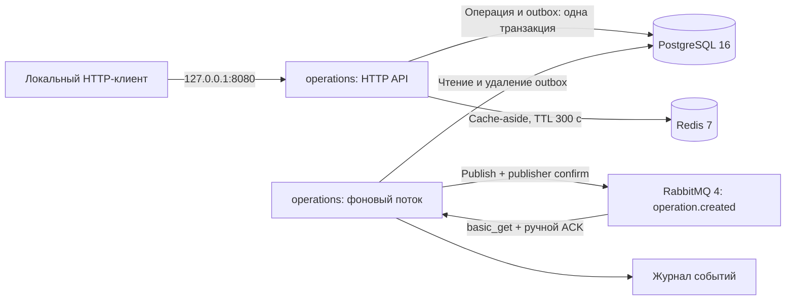

# Контекст проекта

## Материалы защиты и повторный прогон, 15 ноября 2026 года

В defense/ подготовлены актуальные презентация и PDF (30 слайдов: 8 основных и 22 доказательства), ZIP исходников, TALK.md на 4 минуты и реальные записи проверок. В docs/MANUAL_CHECKS.md есть полный ручной чек-лист. Обязательный сценарий запрета нужного соединения теперь выполнен: scripts/verify_firewall_outage.py фиксирует HTTP 200/503/200, счётчик и возврат правила в finally. Полные IPv4/IPv6 filter и NAT правила обоих приложений сохранены в evidence.

Новый полный HA-прогон: pg3 → pg1, 20,922 с; rabbit2 → rabbit1, 8,978 с. Затем холодный запуск restore с готовыми образами: 4,148 с, все поля 21 операции совпали. Обработана временная недоступность метаданных очереди в тесте verify_hw5.py. Все остановленные узлы и restart policy возвращены. Организационный пробел: анонимный GitHub API вернул 404, нужен доступ преподавателя к репозиторию или ссылке на ZIP. Технические сценарии не гарантируют оценку без понимания проекта обоими участниками.

## Веб-интерфейс, 15 ноября 2026 года

Добавлен отдельный frontend «Копилка» на nginx с HTML/CSS/JavaScript. Порт 127.0.0.1:8080 теперь публикует frontend; operations доступен через него, только внутри сети edge. Доступны доход/расход, сводка и категории, фильтры, поиск, пагинация, полный CRUD. Добавлены kind с автоматическим expense для старых записей, SQL-файл схемы и миграции, PUT/DELETE с инвалидацией Redis. Outbox не связан FK с operations: создание доставляется даже после удаления записи. 16 основных сервисов + restore. Исходные данные сохранены. Пробелы frontend/CRUD/SQL-файла из предыдущих оценок закрыты; демонстрация блокировки нужного соединения FW и обновление презентации ещё нужны. Подробнее — README, раздел «Веб-интерфейс».

## Актуализация: ДЗ 5, 15 ноября 2026 года

Стенд переведён на три PostgreSQL/Patroni, три etcd, три RabbitMQ с quorum-очередью, стабильные db/broker через HAProxy и ежедневные pg_dump с восстановлением в отдельную БД. Пять исходных операций перенесены с проверкой, старые тома сохранены. Проверенный failover после SIGKILL: PostgreSQL pg1 → pg2 за 21.397 с, RabbitMQ rabbit2 → rabbit3 за 8.15 с. Проверены чтение мимо кэша, сохранность подтверждённого события и восстановление полного содержимого операций. ДЗ 4 продолжает проходить. Детали и ограничения однохостового стенда: [HW5.md](HW5.md). В текущем Compose 15 основных сервисов плюс отдельный restore-профиль. Презентация/ZIP, созданные ранее в output/defense, пока не обновлены. Требования frontend/CRUD/SQL-файла и дополнительного сценария ДЗ 4 остаются отдельными незавершёнными пунктами защиты.

## Уточнение требований защиты, 15 ноября 2026 года

Изучен отдельный PDF о промежуточной защите. Он расширяет краткие задания семинаров: нужны отдельный front, полный CRUD и SQL-файл схемы, демонстрация ошибки при блокировке нужного сетевого соединения, HA/failover БД и брокера, backup/restore и обоснованные параметры обслуживания. По этому чек-листу текущий проект пока не готов полностью: этапы 2–4 закрыты частично, этап 5 отсутствует. Предыдущие оценки выполнения ДЗ относятся к кратким семинарским формулировкам. Подробный актуальный чек-лист: [требования защиты](DEFENSE_REQUIREMENTS.md). Групповая демонстрация для Марата и Юсуфа — 4 минуты, оба должны понимать весь проект. Код и презентация при изучении требований не менялись.

## Актуализация: ДЗ 4 выполнено

9 ноября 2026 года добавлены сети edge/data/messaging и firewall прикладных сервисов. Consumer вынесен в отдельный notifications: он подключён только к messaging, имеет разрешение на RabbitMQ и явные запреты на PostgreSQL/Redis. Operations сохраняет HTTP API, БД, кэш и outbox publisher. Правила устанавливаются при запуске, приложения работают от nobody без effective capabilities.

Стенд собран и запущен локально: пять healthy-контейнеров. Интеграционная проверка подтвердила сетевые ALLOW/DENY, рост счётчиков REJECT, POST и GET database/cache, получение события сервисом notifications. Создана локальная игнорируемая `.env`. ДЗ 5 пока не реализовано; следующий учебный этап — надёжность и резервные копии. Подробности, IP-план, матрица и команды: [ДЗ 4](HW4.md). Проверка: `python3 scripts/verify_hw4.py`.

## Исторический снимок до выполнения ДЗ 4

Ниже сохранён исходный разбор на 9 ноября 2026 года, до добавления notifications, сетей и FW. Изучены все отслеживаемые файлы и история из четырёх коммитов до `298bc49`, а также 10 PDF из архива курса (318 страниц). Упоминания отсутствия ДЗ 4 и непроверенного запуска ниже относятся к исходному состоянию; актуальное состояние описано выше и в HW4.md.

## Назначение и границы

Групповой учебный проект «Трекер личных финансов» для курса «Безопасность высоконагруженных систем», образовательный центр VK в ВШЭ. Состав группы в HOMEWORK.md пока не заполнен.

Замысел: доходы/расходы, месячные бюджеты по категориям, уведомления о превышении лимита и стоимость инвестиционного портфеля. Демонстрационный сценарий: расход на продукты → сохранение → пересчёт бюджета → уведомление при превышении лимита. Внешние котировки не должны блокировать запись расхода.

Реализована только запись и чтение положительной суммы с категорией. Нет пользователей, счетов, валюты, типа доход/расход, бюджетов, портфеля, внешних API, UI и сервиса уведомлений. Наличие четырёх контейнеров означает один прикладной сервис и три инфраструктурных компонента.

## Карта исходного репозитория

| Файл | Содержимое |
|---|---|
| `README.md` | Назначение, локальный запуск, ручная демонстрация ДЗ 2–3 |
| `HOMEWORK.md` | Предметная область и требования ДЗ 1–5 со ссылками на страницы семинаров |
| `docker-compose.yml` | Operations, PostgreSQL, Redis, RabbitMQ, healthcheck и тома |
| `operations/server.py` | Весь HTTP API, схема БД, кэширование и фоновый обработчик событий |
| `operations/requirements.txt` | psycopg[binary] 3.2.13, redis 6.4.0, pika 1.3.2 |
| `operations/Dockerfile` | Python 3.13 Alpine, установка зависимостей, запуск от nobody |
| `.gitignore` | Исключает `.env` |

На момент изучения нет `.codegraph/`, тестов, CI/CD и дополнительных прикладных модулей. История: описание требований → описание трекера → стенд ДЗ 2 → интеграции ДЗ 3.

## Реализованная архитектура

API и worker находятся в одном Python-процессе. `initialize()` создаёт таблицы, затем запускаются daemon-поток `events()` и `ThreadingHTTPServer`.

### HTTP-контракт

| Метод и путь | Поведение |
|---|---|
| `GET /` | 200, `{"message":"Hello, world!"}` |
| `POST /operations` | JSON с `amount` и `category`; 201 и UUID, сумма и категория |
| `GET /operations/{uuid}` | 200 и `id`, `amount`, `category`, `created_at`; заголовок `X-Data-Source: database` или `cache` |

Сумма обрабатывается через Decimal: конечная, больше нуля, меньше 10^12, численно кратна 0.01. Рекомендуемый ввод — строка, как в README. Категория после trim должна иметь длину 1–100. Тело POST ограничено 16 384 байтами по Content-Length. Ошибка входа → 400; отсутствующая операция/неизвестный путь → 404; перехваченная ошибка PostgreSQL → 503. Поддерживаются GET и POST; остальное остаётся стандартному HTTP-серверу.

### Данные и согласованность

- `operations`: UUID PK, `amount NUMERIC(14,2)` с CHECK > 0, категория, время создания TIMESTAMPTZ.
- `outbox`: UUID PK/FK на operations и JSON-событие в TEXT. Операция и outbox коммитятся вместе.
- POST сбрасывает `operation:{uuid}`. UUID новый, поэтому такой ключ обычно ещё отсутствует.
- GET сначала читает Redis, при промахе читает PostgreSQL и заполняет Redis на 300 секунд. При RedisError продолжает работу через БД.
- Worker объявляет durable-очередь `operation.created`, публикует persistent-сообщение с message_id = UUID и ждёт publisher confirm. Запись outbox удаляется после подтверждения в транзакции БД.
- Затем тот же worker читает одно сообщение через basic_get, логирует payload и делает ACK. При сбое переподключается с паузой 2 секунды.
- Между подтверждением RabbitMQ и коммитом удаления outbox возможен сбой: событие будет опубликовано повторно. Гарантия допускает повторы, exactly-once нет.
- Consumer сейчас только пишет лог; бизнес-эффекты и дедупликация не реализованы. Повторный POST создаёт новый UUID и новую операцию: Idempotency-Key нет.

### Развёртывание

Compose поднимает `operations`, `db`, `cache`, `broker`. Operations ждёт healthy-состояния всех трёх зависимостей при запуске. Пароль обязателен через POSTGRES_PASSWORD; он же используется для RabbitMQ. В README есть команда создания `.env`; секретов в исходном репозитории нет, `.env` не создавался при изучении.

Только HTTP-порт опубликован на loopback хоста. PostgreSQL и RabbitMQ имеют именованные тома `db-data`, `broker-data`; Redis — восстанавливаемый кэш без отдельного тома. Явные сети не заданы: общая default-сеть Compose. Политик restart, реплик и балансировщика нет.

## Сопоставление с ДЗ

| Этап | Состояние по файлам | Что ещё требуется / предел вывода |
|---|---|---|
| ДЗ 1 | Предметная область и групповой формат описаны | Вписать участников |
| ДЗ 2 | Четыре компонента и hello-world описаны в Compose | Фактический запуск здесь не проверялся |
| ДЗ 3 | Чтение/запись БД и кэша, publish/consume реализованы | Ручная демонстрация по README, запуск здесь не проверялся |
| ДЗ 4 | Не реализовано | Сетевые сегменты, FW, явный allow и deny с воспроизводимыми проверками |
| ДЗ 5 | Не реализовано | Параметры обслуживания, HA собственных и инфраструктурных сервисов, backup БД |

Семинар 1, стр. 7: к коллоквиуму ожидается несколько прикладных сервисов, БД, брокер и кэш. Один operations с отдельным потоком ещё не даёт несколько прикладных сервисов. Формулировки первых пяти ДЗ и контекст курса: [конспект](course/README.md).

## Важные ограничения для следующих изменений

Это наблюдения по коду, а не результаты нагрузочного теста или аудита:

1. `GET /` проверяет только HTTP-процесс. Сбой worker или БД не меняет его успешный ответ. Healthcheck и тома не доказывают HA или наличие резервной копии.
2. Падение RabbitMQ после запуска не блокирует сохранение операции: outbox остаётся в БД. Но первый запуск через Compose зависит от healthy брокера и кэша; при недоступной БД `initialize()` завершится ошибкой.
3. Один экземпляр каждой службы и один хост оставляют точки отказа. Outbox защищает согласованную запись события, но не заменяет отказоустойчивость БД.
4. Нет аутентификации, авторизации и привязки операций к пользователю. Для учебного локального стенда опубликован loopback; для пользовательского продукта потребуется отдельное решение доступа.
5. Пароль PostgreSQL и RabbitMQ общий, межсервисное шифрование и FW-политики не настроены. Запросы SQL параметризованы, контейнер operations работает от nobody.
6. Worker выбирает весь outbox без лимита, сортировки и блокировки строк; сетевое ожидание публикации происходит внутри транзакции БД. Параллельные worker и большие очереди требуют отдельной проработки.
7. Publisher и consumer делят поток. Проблема публикации/БД останавливает также потребление до следующей успешной итерации.
8. Политика повторов простая, без backoff и dead-letter queue. Нет метрик задержки outbox/очереди, trace ID, алертов, HTTP-идемпотентности и тестов.
9. Стандартный ThreadingHTTPServer, отсутствие пула БД и прикладных ограничений параллелизма означают, что высокая нагрузка пока не доказана.
10. В HOMEWORK.md осталась ссылка на архив по прежнему пути `/home/user/Downloads/Архив.zip`. Доступные копии материалов теперь лежат в `docs/course/materials/`.

## Ориентиры для дальнейшей работы

Следующий последовательный учебный этап — ДЗ 4, затем ДЗ 5. Возможный дополнительный прикладной сервис — асинхронные уведомления или бюджеты; это предложение, а не уже принятое решение. Запись операции должна оставаться независимой от доставки уведомления и внешних котировок. Для операций с бизнес-эффектами нужны идемпотентность и защита доменных инвариантов.

Описания возможностей, требования курса, предложения и проверенные результаты запуска следует учитывать раздельно. При этом изучении приложение и инфраструктура не запускались, исходный код не менялся.
